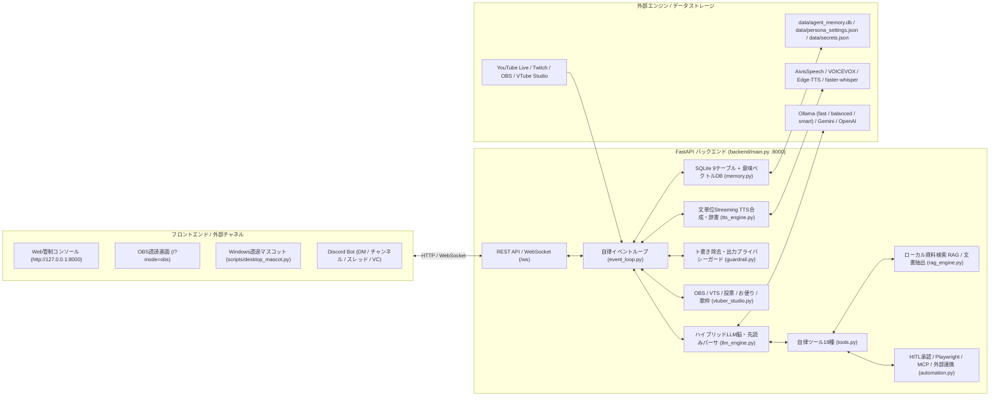

# NIA（ニア）統合仕様書 ＆ 取扱説明書

> **対象システム**: AIエージェント 管制コンソール & 自律型VTuber 配信スタジオ（`NIA // AUTONOMOUS CORE v3.0` / 第2世代統合版）  
> **リポジトリ**: `d:\Documents\000MyTool\MyAgent`  
> **補助チェックガイド**: [拡張機能チェックガイド_全24種.md](file:///d:/Documents/000MyTool/MyAgent/拡張機能チェックガイド_全24種.md)

---

## 1. システム概要・アーキテクチャ

**NIA（ニア）** は、ローカルLLM（Ollama ハイブリッドルーティング対応）およびクラウドLLM（Gemini / OpenAI互換）を頭脳とし、**「デスクトップ常駐AI秘書（AIエージェントモード）」** と **「自律型AI配信者（自律型VTuberモード）」** を1クリック・プリセットで切り替えられる統合自律システムです。

### 主な技術スタック
- **バックエンド**: Python / FastAPI / Uvicorn / WebSocket / SQLite (`data/agent_memory.db`)
- **日本語形態素・意味ベクトルエンジン**: `SudachiPy`（`core` 辞書）＋ 概念同義語クラスタ ＋ 2-gram ハッシングによるローカル 256次元 L2正規化意味ベクトル検索（追加VRAM・外部API不要）
- **フロントエンド**: Vanilla HTML5 / CSS3 / JavaScript (ES Modules) / Web Audio API (`DynamicsCompressorNode` ピークリミッター内蔵 + 周波数帯域別母音推定リップシンク)
- **ネイティブ常駐マスコット**: Python `tkinter` + `Pillow`（Windows Per-Monitor DPI 対応・背景カラーキー完全透過）
- **対応LLM & ルーティング**:
  - Ollama ハイブリッド自動切替（`fast`: `gemma4:e4b` / `balanced`: Agent時 `huihui_ai/gemma-4-abliterated:12b`・VTuber時 `gemma4:12b` / `smart`: `gemma4:26b` ＋ 1パス自己レビュー）
  - クラウドAPI（Google Gemini / OpenAI互換API）
- **対応TTS・STT**:
  - **音声合成 (TTS)**: AivisSpeech（推奨）、VOICEVOX、Edge-TTS、ブラウザ標準音声合成（文単位Streaming先読み連続再生対応）
  - **音声認識 (STT)**: ローカルマイク VAD + `faster-whisper` (`cpu int8`) / ブラウザ音声入力

---

## 2. ディレクトリ・ファイル構成

| パス | 役割 |
| :--- | :--- |
| [NIA_起動・再起動.vbs](file:///d:/Documents/000MyTool/MyAgent/NIA_起動・再起動.vbs) | **黒画面（cmd）を出さずに**サーバーを起動/再起動し、ブラウザを開く |
| [NIA_マスコット常駐のみ起動.vbs](file:///d:/Documents/000MyTool/MyAgent/NIA_マスコット常駐のみ起動.vbs) | **黒画面なし**で裏サーバーを起動し、デスクトップ常駐マスコットのみを起動 |
| [NIA_完全停止.vbs](file:///d:/Documents/000MyTool/MyAgent/NIA_完全停止.vbs) | 稼働中のサーバー・常駐マスコット・関連プロセスを一括完全停止 |
| [start_agent.bat](file:///d:/Documents/000MyTool/MyAgent/start_agent.bat) | コンソール出力を確認しながら起動する開発・デバッグ用バッチ |
| [main.py](file:///d:/Documents/000MyTool/MyAgent/backend/main.py) | FastAPI サーバー、全REST API、WebSocket (`/ws`)、静的ファイル配信 |
| [config.py](file:///d:/Documents/000MyTool/MyAgent/backend/config.py) | `AgentConfig`、スキルプリセット定義（`SKILL_PRESETS` 5種）、設定・秘密情報分離永続化 |
| [models.py](file:///d:/Documents/000MyTool/MyAgent/backend/models.py) | `AgentEvent`, `AgentStructuredOutput`（`speech_sub`, ルーターメタ情報等）, `EventSource`, `EmotionType` |
| [event_loop.py](file:///d:/Documents/000MyTool/MyAgent/backend/event_loop.py) | 優先度付きイベントキュー、`speech_ready`＋`speech_chunk` 先読み配信、自律監視・睡眠統合・話題デッキ制御 |
| [llm_engine.py](file:///d:/Documents/000MyTool/MyAgent/backend/llm_engine.py) | ハイブリッド自動ルーティング、`IncrementalJsonSpeechExtractor`、ReAct ツールループ、自己レビュー、バイリンガル翻訳 |
| [tools.py](file:///d:/Documents/000MyTool/MyAgent/backend/tools.py) | 全17種類の自律ツール実装・モード別ツール仕様生成（`build_tools_spec`） |
| [automation.py](file:///d:/Documents/000MyTool/MyAgent/backend/automation.py) | HITLコマンド承認 (`ApprovalManager`)、Playwright操作、MCPクライアント、GitHub/iCal/Gmail連携、Windows制御・トースト監視 |
| [rag_engine.py](file:///d:/Documents/000MyTool/MyAgent/backend/rag_engine.py) | 許可フォルダ内ファイル読み書き・PDF/Word/Excel/PPTX抽出・SQLite FTS5 ローカルRAG検索 |
| [tts_engine.py](file:///d:/Documents/000MyTool/MyAgent/backend/tts_engine.py) | AivisSpeech / VOICEVOX / Edge-TTS 合成、読み上げ辞書適用、音声キャッシュ掃除 |
| [memory.py](file:///d:/Documents/000MyTool/MyAgent/backend/memory.py) | SQLite 8テーブル永続化、`SudachiPy` 意味ベクトル検索、`consolidate_memories()` 重複統合・整理 |
| [live_stream.py](file:///d:/Documents/000MyTool/MyAgent/backend/live_stream.py) | YouTube Live (`pytchat` / HTMLスクレイピング)・Twitch (IRCv3 タグ: Bits/Sub/Raid) コメント取得・バッチ集約 |
| [vtuber_studio.py](file:///d:/Documents/000MyTool/MyAgent/backend/vtuber_studio.py) | OBS WebSocket v5 連携、VTube Studio API、投票/クイズ/大喜利、画面変化実況、歌枠 LRC 同期、配信アーカイブ生成 |
| [discord_connector.py](file:///d:/Documents/000MyTool/MyAgent/backend/discord_connector.py) | Discord Bot 双方向連携（スレッド分離、画像/音声/文書添付解析、VC接続TTS発話、コマンド実行ボタン通知） |
| [audio_io.py](file:///d:/Documents/000MyTool/MyAgent/backend/audio_io.py) | ローカルマイク常時待機 VAD ＋ `faster-whisper` 文字起こし |
| [guardrail.py](file:///d:/Documents/000MyTool/MyAgent/backend/guardrail.py) | NGワード・インジェクション検知、`（笑顔で）` 等のト書き自動除去、VTuber出力PIIハードマスク、読み上げ辞書変換 |
| [index.html](file:///d:/Documents/000MyTool/MyAgent/frontend/index.html) | Web管制コンソール（シンプル/フルUI切替・プリセット・バイリンガル字幕・統合設定8タブ）/ OBS透過画面 |
| [app.js](file:///d:/Documents/000MyTool/MyAgent/frontend/js/app.js) | WebSocket制御、`speech_ready`確定字幕・Sequential Audio Streaming再生、Web Audio リミッター＆母音口パク、D&D解析 |
| [avatar.js](file:///d:/Documents/000MyTool/MyAgent/frontend/js/avatar.js) | 高精細立ち絵レンダリング、瞬き・6感情・`a/i/u/e/o` 母音口パク、スパチャ祝祭エフェクト |
| [style.css](file:///d:/Documents/000MyTool/MyAgent/frontend/css/style.css) | サイバーダークUI、シンプルUI (`body.ui-simple`)、バイリンガル字幕、OBS透過・各種配信カード演出 |
| [desktop_mascot.py](file:///d:/Documents/000MyTool/MyAgent/scripts/desktop_mascot.py) | Windows ネイティブ枠なし・完全背景透過デスクトップマスコット本体 |
| [launcher.pyw](file:///d:/Documents/000MyTool/MyAgent/scripts/launcher.pyw) | VBSランチャーから呼ばれるウィンドウ非表示プロセス管理エンジン |
| `data/persona_settings.json` | ペルソナ・UI・音声・配信・拡張機能などの設定永続化ファイル（機密キー除く） |
| `data/secrets.json` | Discord Bot トークン、APIキー、GitHubトークン、OBSパスワード等の機密情報ファイル |
| `data/agent_memory.db` | 会話・意味ベクトル記憶・タスク・リスナー・ワークフロー・お便り・配信記録用 SQLite DB |
| `data/rag_docs/`, `data/karaoke/`, `data/research_reports/`, `data/stream_archives/` | RAG索引対象資料、歌枠楽曲(`.wav/.mp3`+`.lrc`)、Deep Research報告書、配信アーカイブ出力先 |

---

## 3. 起動・終了・アクセス方法（クイックスタート）

### 3.1 起動と完全停止
1. **[NIA_起動・再起動.vbs](file:///d:/Documents/000MyTool/MyAgent/NIA_起動・再起動.vbs)** をダブルクリックします（ポート `8000` でサーバーを起動しブラウザを開きます）。
2. マスコットだけ画面に常駐させたい場合は **[NIA_マスコット常駐のみ起動.vbs](file:///d:/Documents/000MyTool/MyAgent/NIA_マスコット常駐のみ起動.vbs)** をダブルクリックします。
3. 完全に停止したい場合は **[NIA_完全停止.vbs](file:///d:/Documents/000MyTool/MyAgent/NIA_完全停止.vbs)** をダブルクリックします。

### 3.2 アクセス URL 一覧
| 用途 | URL | 説明 |
| :--- | :--- | :--- |
| **メイン管制コンソール** | `http://127.0.0.1:8000/` | 全機能操作・設定・チャット・ライブ制御を行う標準画面 |
| **OBS Studio 透過画面** | `http://127.0.0.1:8000/?mode=obs` | 背景完全透過。ニュース引用カード・投票バー・お便り・歌枠歌詞・バイリンガル字幕を OBS「ブラウザソース」へそのまま映せます |
| **ブラウザ簡易マスコット** | `http://127.0.0.1:8000/?mode=mascot` | ブラウザ上でマスコット縦長表示のみを行うモード |

---

## 4. 基本操作 ＆ 第2世代 主要機能ガイド

### 4.1 ヘッダーバー（最上部コントロール）
- **モード切替**: `🛡️ AIエージェント (戦術・常駐モード)` ⇄ `📺 自律型VTuber (ライブ配信モード)`。
- **自動ルーターバッジ (`#router-status-pill`)**: 質問ごとに自動選択されたモデルとティア（`⚡ FAST` / `⚖️ BALANCED` / `🧠 SMART`）をリアルタイム表示。
- **AivisSpeech ワンクリック裏起動 (`#btn-start-aivis`: `🚀 Aivis裏起動` / `🟢 Aivis稼働中`)**: 二重起動を防止しつつ、ウィンドウを出さずにバックグラウンドで AivisSpeech エンジン (`:10101`) を起動します（既に GUI が表に出ている場合は裏へ格納します）。
- **スキルプリセットパック (`#select-skill-preset`)**: 1クリックで用途別にモード・UI密度・ルーター・各種ツールを一括切替します。
  - `☀️ 秘書・日課自動化パック` (`morning_secretary`): Agent・シンプルUI・自動ルーティング＋自己レビュー・朝08:00ブリーフィング自動確保
  - `💻 開発・設計アーキテクトパック` (`dev_architect`): Agent・フル管制・RAG/Playwright/承認実行・自動昇格ON
  - `📺 配信・雑談＆多言語パック` (`vtuber_talk`): VTuber・シンプルUI・高速優先・英日バイリンガル字幕ON・高速コメバッチ
  - `🎉 配信・企画フル演出パック` (`vtuber_variety`): VTuber・フル管制・参加型企画/SE/配信テロップ/バイリンガル字幕ON
  - `🪶 軽量ミニマル常駐パック` (`zero_burden`): Agent・シンプルUI・高速モデル固定・バックグラウンド監視OFF
- **表示粒度トグル (`🌱 シンプルUI` ⇄ `⚙️ フル管制`)**: `シンプルUI` にすると詳細な監視数値・思考ログ・高度な企画/運用カードを隠し、すっきりした作業画面になります。
- **バイリンガル字幕トグル (`🌐 字幕:OFF / EN / KO / ZH`)**: リアルタイム翻訳の第2言語字幕をワンクリックでON/OFF（OBS透過画面・チャット欄とも連動）。
- **`⏹️ 発話停止`（または `Esc` キー）**: 音声・Streaming再生キュー・口パクを即座に強制停止。
- **`🔊 音声ON / 🔇 ミュート中`**, **`🐾 常駐マスコット起動`**, **`⚙️ ペルソナ・統合設定`**, **`🎥 OBS透過画面`**。

### 4.2 左・中央・右パネルの基本操作
- **左パネル**:
  - システム診断・アクティブウィンドウ表示・ポモドーロタイマー・LLM/TTS切替・自律トーク制御（`フル管制` 時）。
  - **🧠 長期記憶**: 手動追加 (`＋追加`)、一括消去に加え、**意味検索欄 (`🔍 意味検索`)** から文字一致なしでも類似記憶（`類似 XX%`）を検索可能。**`🧹整理`** ボタン（または30分以上アイドル時の自動睡眠統合）で重複記憶を自動マージ整理します。
  - **📅 予定・監視タスク**: 単発および繰り返しリマインダー (`none` / `hourly` / `daily` / `weekly`) の登録・完了・スヌーズ。
- **中央ステージ**:
  - **ワードローブ ＆ ふれあいバー (`.wardrobe-bar`)**: 本日のデレ度ゲージ (`Lv.1〜Lv.5`, 日付変更リセット・30分放置自然減衰・`↺` 手動ツン戻し対応)・時間帯/天気チップ・`✋ ふれあいON ⇄ ✥ 位置移動` トグル・4衣装切替 (`制服` / `パジャマ` / `私服` / `メイド服`)・`😳 照れチーク` ON/OFF。新規衣装は `python scripts/build_outfit_assets.py --id <ID> --src <画像>` でAI完全透過アセットを自動生成可能。
  - **ふれあいインタラクション**: `✋ ふれあいON` 時は頭部ドラッグで「なでなで」（ハート演出＋照れ音声＋好感度+5）、頬クリックで「つつく」（驚き＋キラキラ＋好感度+2）。位置移動したい場合は `✥ 位置移動` へ切替または `Shift + 左ドラッグ`。
  - 立ち絵の拡大縮小（ホイール）・全身/顔切替・2.5D呼吸＆カーソル傾き追従・時間帯/天気背景ライティング（OBS/マスコット透過時は自動無効）・表情/口形手動確認（`フル管制` 時）。
  - **ファイル D&D 解析**: `.txt`, `.md`, 画像, `.pdf`, `.docx`, `.xlsx`, `.pptx`, `.mp3`/`.wav` 等を中央ステージへドロップして即座に解析・要約。
  - **HITL コマンド承認バナー**: `run_command` 承認要求時に画面上部へ黄色いバナーが表示され、ワンクリックで「許可して実行 / 拒否」を判断できます。
  - **安定字幕 (`#subtitle-box`)**: LLMが発話全文を確定したタイミング（`speech_ready` / `agent_response`）で完成版セリフを1回だけ表示するため、先読みTTS再生中でも字幕が途中で書き換わらず安定します。また `（笑顔で）` などのト書き括弧は表示・読み上げ直前に自動除去されます。
- **右パネル**:
  - **LIVE CHAT**: 対話履歴・ツール引用元データ（折りたたみ付き）・バイリンガル第2言語翻訳行を表示。
  - **AGENT 自律運用（Agent時・フル管制）**: ⏰ 定時自律ワークフロー（朝ブリーフィング / Web更新hash監視）＋ 🔄 RAG索引化 ＋ 🔍 Deep Research 並列調査起動。
  - **VTUBER 配信スタジオ（VTuber時）**:
    - **`🎲 話題デッキ発動`**: 手動クリック時は話題デッキから次のテーマへ進め、OBSテロップ・OBSシーンを切り替えます（※無言防止タイマー自動発火時は `talk_deck_auto_advance` が OFF の間は配信テーマやシーンを勝手に切り替えず、現在のテーマに沿った繋ぎ雑談のみ行います）。
    - **🎵 配信BGM / 5種シーン (`雑談`・`深夜まったり`・`ニュース解説`・`ゲーム・緊張`・`エンディング`)**: 発話中オートダッキング対応シンセBGM。
    - **🔴 配信記録開始 / 終了**: 配信ハイライトを記録し、終了時にタイムスタンプチャプター・X告知文・Markdownアーカイブ (`data/stream_archives/`) を自動生成。
    - **📊 参加型投票・クイズ・大喜利**, **📮 お便り箱**, **🎤 歌枠 (LRC歌詞同期)**, **👥 常連リスナー記憶**（`フル管制` 時）。

### 4.3 Windows ネイティブ透過デスクトップマスコット
- **左ドラッグ**: 移動 / **ダブルクリック**: 足元ミニチャット開閉 / **ホイール**: サイズ変更 (`55%〜220%`)
- **右クリックメニュー**: ミニチャット開閉、全身⇄バストアップ切替、サイズ・高さ調整、画面認識 (`Vision`)、クリップボード解析、ホバー時透過 ON/OFF、コンソール開く、終了。

---

## 5. 統合設定モーダル（全8タブ仕様）

設定はモーダル内 **8つのタブ** に整理され、`data/persona_settings.json`（一般設定）と `data/secrets.json`（トークン・パスワード類）へ安全に分離保存されます。

1. **🎭 ペルソナ**: エージェント名 (`{agent_name}`)、AIエージェント用・VTuber用それぞれの性格/口調プロンプト、プロバイダ別基本設定（Ollama / Gemini / OpenAI）。
2. **🐾 マスコット・視覚・監視**: マスコット倍率・初期位置・最前面・透過、Visionキャプチャ対象・除外アプリ・監視間隔、フルスクリーン時自動ミュート、ポモドーロ時間、PTTホットキー・ウェイクワード、クリップボード自動監視、Windows スタートアップ自動起動登録。
3. **📺 配信接続・企画・NG検閲**: YouTube Video ID / Twitch チャンネル、コメント取得間隔・キュー上限、無言防止 (Silence Breaker) 発動秒数（標準推奨 `90秒`）、話題デッキ自動ニュース検索、無言時テーマ自動切替 ON/OFF (`#cfg-talk-auto-advance`)、話題デッキテーマ一覧、カスタムNGワード＆対処方針。
4. **🔊 ボイス・辞書・OBS演出**: TTSエンジン選択 (`edge_tts` / `voicevox` / `aivisspeech` / `browser`)、話者ID、音量/話速/ピッチ/抑揚、出力オーディオデバイス分離 (`setSinkId`)、音声キャッシュ上限管理・即時クリーンアップ、読み上げ辞書、OBSモーション強度・字幕スケール・SE・BGM音量/ダッキング率・配信テーマサブテロップ表示。
5. **🧠 知能・記憶・予定表**:
   - Web取得文字数/タイムアウト、記憶注入件数、会話履歴ターン数、予定スヌーズ分数。
   - **LLMハイブリッド自動ルーティング**: モード (`auto` / `fast` / `smart` / `off`)、高速モデル (`ollama_model_fast`)、高精度モデル (`ollama_model_smart`)、1パス自己レビュー ON/OFF。
   - **体感遅延対策**: 文単位Streaming先読みTTS再生 ON/OFF。
   - **記憶高度化**: 意味ベクトル検索 ON/OFF、夜間/待機中自動睡眠統合 ON/OFF。
   - **バイリンガル字幕**: 多言語翻訳ON/OFF・翻訳先言語 (`en` / `ko` / `zh`)。
   - **ローカル操作許可リスト (`local_launch`)**: 許可されたアプリ・URL・フォルダ定義。
6. **💬 Discord連携**: Bot有効化・トークン（[secrets.json](file:///d:/Documents/000MyTool/MyAgent/data/secrets.json) 管理）・接続テスト、許可ユーザーID/チャンネルID、通知先ユーザーID、自律発言のDM通知制御、画像/TTS音声添付、スレッド別文脈分離 ON/OFF。
   - **Discord上での主なコマンド**: `!help`, `!status`, `!vision` / `!screen`, `!mode agent` / `!mode vtuber`, `!briefing`, `!research <テーマ>`, `!otayori <質問>`, `!approve <ID>` / `!deny <ID>`, `!joinvc` / `!leavevc`, `!clear`（画像・音声・`.pdf`/`.docx`/テキスト添付にも対応）。
7. **🤖 自律操作・RAG・MCP**: ファイル操作ツール ON/OFF＆許可フォルダ、RAGインデックス ON/OFF＆対象フォルダ、承認制コマンド実行 ON/OFF＆承認ポリシー (`always` / `safe_readonly_auto`)、Playwright ブラウザ操作 ON/OFF、スマートフック・Windows トースト通知監視 ON/OFF、**PCロック/スリープ即時実行 (`windows_power_control_enabled`) ON/OFF**、ローカルマイク VAD + `faster-whisper` STT ON/OFF＆モデルサイズ、MCP サーバー設定 JSON＆接続テスト、GitHub リポジトリ/Token・Google カレンダー `.ics` URL 設定。
8. **🎬 配信連携・OBS・安全**: 高速コメバッチ ON/OFF、ニュース引用カード演出 ON/OFF、ゲーム/動画リアルタイム画面変化検知実況（間隔・許可ウィンドウ名指定）、相方コラボモード ON/OFF、OBS WebSocket v5 接続設定＆シーン名マッピング（`talk` / `news` / `game` / `karaoke` / `brb`）、VTube Studio API 接続設定＆テスト、口外禁止プライベートワード（ハードマスク対象）。

---

## 6. 自律ツール一覧 & SQLite データベース構成

### 6.1 自律ツール全17種（[tools.py](file:///d:/Documents/000MyTool/MyAgent/backend/tools.py)）
> ※ **VTuberモード**時は配信安全性確保のため、ツール `1〜5` のみに自動制限されます。

| # | ツール名 | 機能 |
| :-: | :--- | :--- |
| 1 | `get_weather` | 気象庁データによる天気・気温(℃)・降水確率(%)の公式予報取得 |
| 2 | `web_search` | Yahoo!/Bing/ニュース/Wikipedia から日付・URL付きWeb検索 |
| 3 | `fetch_webpage` | 指定URLページの本文テキスト深掘り抽出 |
| 4 | `vision_capture` | アクティブウィンドウ・全画面・クリップボードの視覚キャプチャ解析 |
| 5 | `system_diagnostics` | RAM・ディスク使用率・現在時刻・アクティブウィンドウ診断 |
| 6 | `save_memory` | 長期記憶 DB へ重要事実・好みを意味ベクトル付きで永続保存 |
| 7 | `search_memory` | キーワードおよび意味ベクトルによる長期記憶検索 |
| 8 | `manage_task` | 単発・繰り返しリマインダー/タスクの登録・一覧・管理 |
| 9 | `local_launch` | 許可リスト登録済みアプリ・URL・フォルダの安全起動 |
| 10 | `file_op` | 許可フォルダ内ファイル (`list_dir` / `read_file` / `write_file` / `search_files`) 操作・文書解析 |
| 11 | `rag_search` | ローカル資料フォルダ（SQLite FTS5）の横断ドキュメント検索 |
| 12 | `run_command` | 承認ゲート（Web UI + Discord ボタン）経由の PowerShell コマンド実行 |
| 13 | `browser_action` | Playwright ヘッドレス Chromium による動的SPA閲覧・クリック・入力・スクショ |
| 14 | `deep_research` | 裏スレッドでの並列Web検索・複数記事比較 Markdown レポート生成 |
| 15 | `external_service` | GitHub Issue/PR/Commit/通知、Google カレンダー `.ics`、Gmail 取得 |
| 16 | `mcp_tool` | 外部 MCP サーバー (`stdio` JSON-RPC) のツール一覧取得＆呼び出し |
| 17 | `windows_control` | Windows メディア再生・音量操作・アクションセンター通知読取、およびマスター直接指示時の確認なしPCロック(`lock_pc`)・スリープ(`sleep_pc`) |
| 18 | `change_appearance` | ニアの衣装着替え（`default` / `pajama` / `casual` / `maid` 等）およびアクセサリー着脱（Agent / VTuber 両モード対応） |

### 6.2 SQLite データベース（`data/agent_memory.db`）全9テーブル
1. `conversations`: 発話ログ（モード・セッション分離・`speech_sub`・ツール引用元 `evidences_json` 保存）
2. `memories`: 長期記憶（意味ベクトル `embedding BLOB`・最終参照時刻 `last_accessed`・参照回数 `access_count` 付き）
3. `tasks`: 予定・アラート・繰り返しタスク
4. `viewer_profiles`: VTuber 常連リスナー記憶（来訪・発言・スパチャ回数・特徴メモ）
5. `workflows`: 定時自律ワークフロー（朝ブリーフィング / Web更新監視）
6. `mailbag_items`: 匿名お便り・質問箱アイテム
7. `stream_sessions`: 配信アーカイブセッション記録
8. `stream_highlights`: 配信内タイムスタンプハイライト（話題・スパチャ・コメント・企画締切）
9. `affection_state`: 好感度（ツン⇄デレ度）ポイント・レベル・なでなで/つつき/会話回数永続化

---

## 7. 主要 API・WebSocket 仕様（[main.py](file:///d:/Documents/000MyTool/MyAgent/backend/main.py)）

| エンドポイント | 用途 |
| :--- | :--- |
| `GET /api/status` | システム状態・最新発話（マスコット同期用） |
| `POST /api/chat`, `POST /api/config` | 対話・コメント投入 / 統合設定更新・永続化 |
| `GET /api/presets`, `POST /api/presets/apply` | スキルプリセット一覧取得 / 1クリック適用 |
| `GET /api/memories/semantic`, `POST /api/memories/consolidate` | 意味ベクトル記憶検索 / 睡眠統合（重複マージ＆整理）即時実行 |
| `POST /api/mascot/toggle`, `POST /api/speech/stop`, `POST /api/voice/mute` | マスコット起動停止 / 発話停止 / ミュートトグル |
| `POST /api/engines/aivisspeech/start` | AivisSpeech の二重起動防止付きバックグラウンド裏起動・GUI裏格納 |
| `GET /api/outfits`, `POST /api/appearance`, `POST /api/interact`, `POST /api/affection/reset` | 衣装一覧取得 / 衣装・チーク変更 / ふれあい反応 / 本日のデレ度をLv.1ツンへ手動リセット |
| `POST /api/vision_analyze`, `/api/clipboard_analyze`, `/api/upload_analyze` | 画面解析・クリップボード・ファイルアップロード解析 |
| `GET/POST/DELETE /api/agent/workflows...` | 定時自律ワークフロー登録・即時実行・切替・削除 |
| `POST /api/agent/rag/reindex`, `GET /api/agent/rag/search` | ローカル RAG インデックス更新 / 検索 |
| `GET/POST /api/agent/research`, `POST /api/agent/mcp/list` | Deep Research 管理 / MCP サーバーツール確認 |
| `GET/POST /api/agent/approvals...` | コマンド実行承認待機一覧＆承認/拒否応答 |
| `POST /api/talk_deck/next`, `POST /api/demo_stream`, `POST /api/topic` | 話題デッキ手動進行 / 模擬コメント流入 / 配信テーマ設定 |
| `POST /api/vtuber/obs/...`, `POST /api/vtuber/vts/test` | OBS WebSocket / VTube Studio 接続テスト・シーン切替 |
| `GET/POST /api/vtuber/poll/...`, `/mailbag...`, `/session/...`, `/karaoke/...` | 投票・企画 / お便り箱 / 配信録画アーカイブ / 歌枠再生 |
| `WS /ws` | `init_state`, `model_routed`, `speech_ready`, `speech_chunk`, `agent_response`, `memories_updated`, 各種オーバーレイ・メトリクス配信 |

---

## 8. トラブルシューティング

1. **声がエコー（二重再生）になって聞こえる**
   - **仕組み**: `BroadcastChannel("nia_audio_sync")` によりメインコンソール稼働中は OBS透過画面（`/?mode=obs`）やマスコット画面側の音声再生を自動で抑制しています。それでも二重になる場合は OBS ソースの「音声モニタリング」設定を確認してください。
2. **AivisSpeech で音が割れる / ピーク歪みが出る**
   - **対策済み**: ピッチ変動抑制・ヘッドルーム (`0.82` 倍) に加え、Web Audio API 側の `-3.0 dBFS` ピークリミッター（`DynamicsCompressorNode`）を通過させています。必要に応じて統合設定タブ「🔊 ボイス」の音量スライダーを下げてください。
3. **ブラウザ画面・機能変更が反映されない**
   - **対処**: [NIA_起動・再起動.vbs](file:///d:/Documents/000MyTool/MyAgent/NIA_起動・再起動.vbs) を実行後、ブラウザ上で **`Ctrl + F5`**（スーパーリロード）を押してください。
4. **ポート `8000` が使用中で起動しない**
   - **対処**: [NIA_完全停止.vbs](file:///d:/Documents/000MyTool/MyAgent/NIA_完全停止.vbs) を実行してから再度起動してください。
5. **バイリンガル字幕 (`🌐 字幕`) が出ない・遅い**
   - **確認ポイント**: 高速モデルと標準モデルの違いによる VRAM スワップを防ぐため、現在は現在推論中のモデル (`routed_model`) で翻訳フォールバックを行います。Ollama が起動し、選択中の翻訳用モデルが利用可能かヘッダーの稼働ランプで確認してください。
